# AI persona responses

Made by `personas/run_personas.py`: each persona's own 20-page book from the app's real pipeline (image model `gpt-image-2.5-flare`, `low` quality to keep the run cheap), reviewed by `gpt-5-mini` playing that persona.

## Denise, 34 (Red Riding Hood): Pediatric nurse in Atlanta, two kids (4 and 7). Reads to them every night. Uses her phone for everything.

 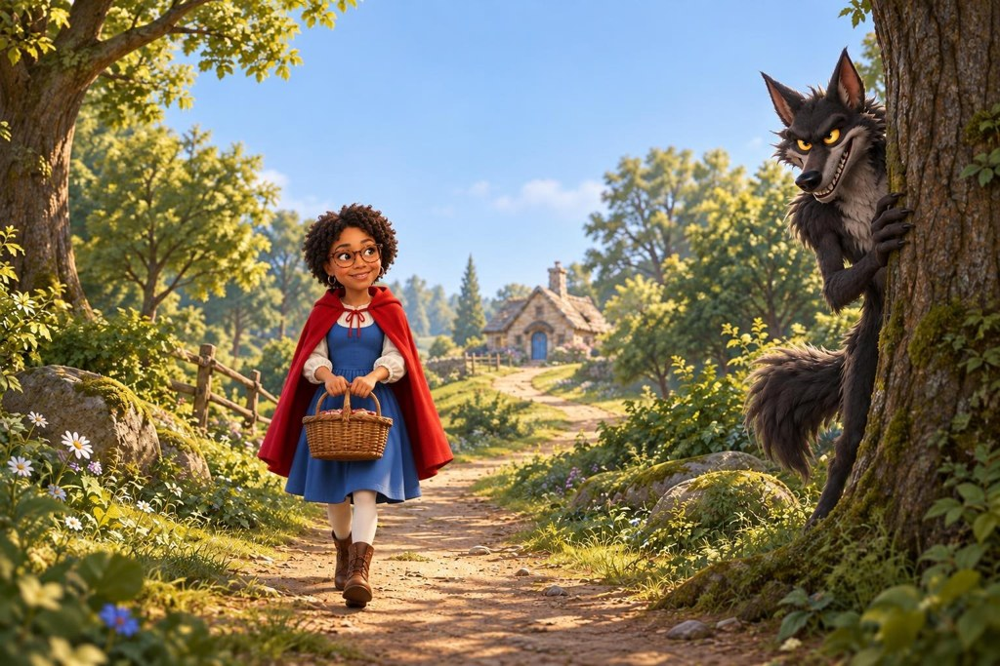 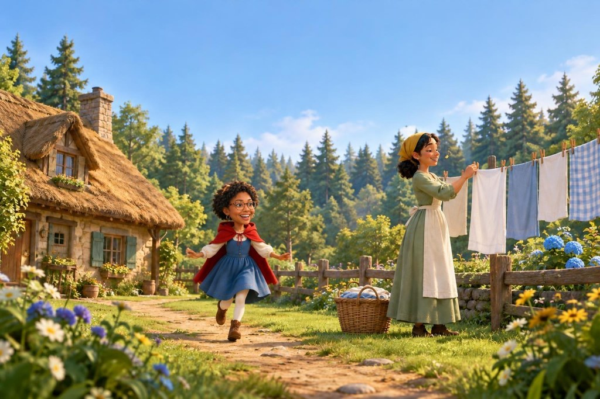 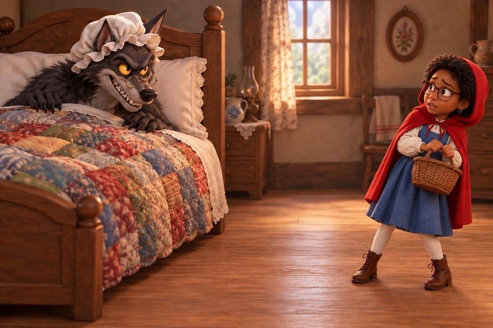

- **Looks like me:** 4/5. Overall I see myself — short curly hair, my skin tone, the tortoiseshell glasses and the smile show up well (cover/page 0 and lots of story pages like 1, 3, 4, 9, 12, 18, 20). It's clearly a stylised, childlike version of me though, with bigger eyes and cartoon proportions, so it's not an exact adult likeness. A couple pages felt odd — page 6 shows two Reds standing together which looks like a glitch, and on a few closeups the glasses/hair details shift slightly.
- **Rings true:** 5/5. The text and images follow the classic Little Red Riding Hood beat by beat and the pacing feels right for a children's picture book. The scenes (path, flowers, Grandma's cottage, wolf in bed, woodcutter) all line up with the traditional story and read naturally to a kid.
- **Professional:** 5/5. The artwork is high quality and consistent — lovely colors, good lighting, polished characters and backgrounds. It looks like a real published children's book page-by-page; I'd be happy to print or gift this as a physical book.
- **What isn't good:** Page 6: two Reds standing side-by-side feels like an error. Some small inconsistencies in glasses and hair detail across pages (looks slightly different on a few closeups). A few images exaggerate child proportions so the likeness feels more ‘inspired by’ than true-to-age — not a dealbreaker but worth noting.
- **Liked:** I loved that the glasses and curly hair were preserved — that made it feel personal. The cottage and forest scenes (pages 8–10, 18) are cozy and perfect for bedtime reading, and the characters' expressions are great. My kids would adore this!

## Hank, 71 (Jack): Retired machinist in Ohio, six grandchildren. Not comfortable with websites; his daughter set up his Gmail.

 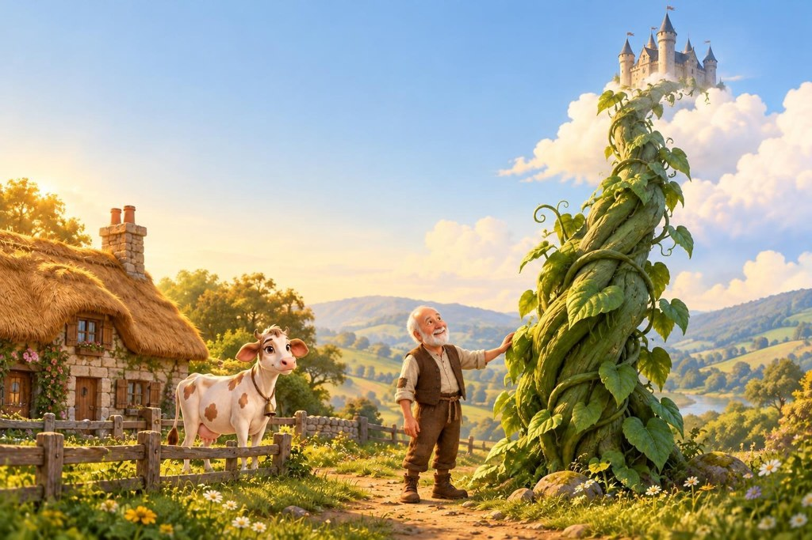 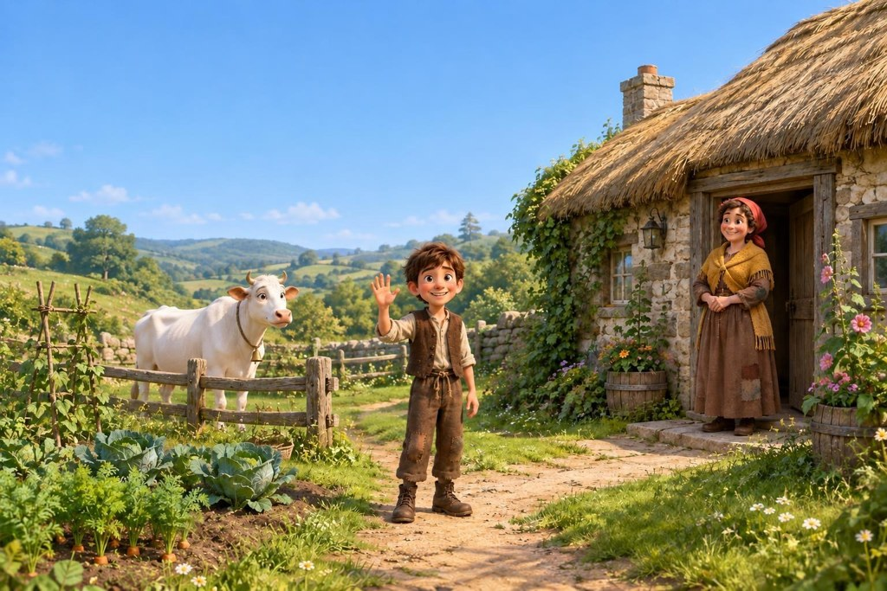 

- **Looks like me:** 3/5. Some pages do look like me. The old bearded fellow with the bald head is close on pages 1, 4, 9, 10, 12 and 16. But it's cartooned and smoothed out. Other pages show a young boy as Jack (pages 2, 3, 14, 15). That inconsistency makes it feel less like my picture and more like a mixed mash.
- **Rings true:** 3/5. Story follows the old Jack and the Beanstalk lines, even the Fee-fi-fo-fum bit, so it's recognizable. But the pictures are very cinematic and sometimes don't match the text or each other. For a real children's book it feels a bit uneven.
- **Professional:** 4/5. Artwork is high quality and polished. Colors, composition and detail look like a professional animation still. My only holdback is the inconsistent character age and a few odd choices (beans look like candy).
- **What isn't good:** Inconsistent hero age — sometimes I'm the old man, sometimes Jack is a young boy (pages 2,3,14,15 vs pages 1,4,9,10,12,16). Beans look like jellybeans on pages 6–7. Some images and text don't line up perfectly. The harp being a little person (page 16) feels odd and out of tone.
- **Liked:** Nice colors and clear pictures. The cow, hen and harp look good for grandkids. The classic lines are there, and the big beanstalk/castle shots are nice.

## Amira, 28 (Red Riding Hood): UX designer in Dearborn. Not a parent. Thinks about every app she uses like a design review.

  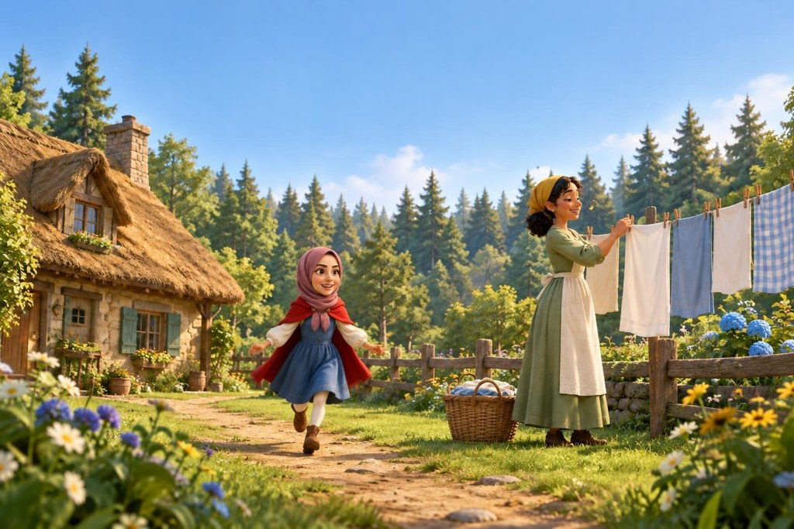 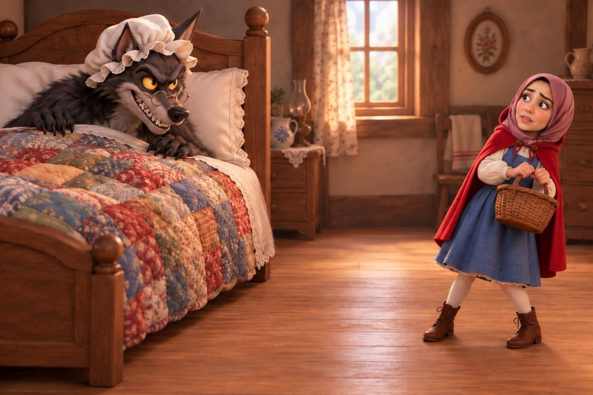

- **Looks like me:** 4/5. Mostly hits — hijab kept, skin tone, thick brows, large brown eyes and overall face shape match the selfie (pages I notice this most: cover, pages 1–4, 8–10, 18). What's off — stylized proportions (bigger eyes, softer jaw) and exaggerated expressions make it clearly a caricature rather than a photo-real likeness. A few indoor frames (pages 11–14) show slightly different cheek/forehead proportions and harder lighting that make the face feel less 'me'.
- **Rings true:** 5/5. Follows the classic Little Red Riding Hood beats and reads like a children's picture book — clear scene progression, short lines per spread, friendly illustration style. Tone and pacing work for young readers. Minor nit: a couple of microcopy choices (ALL CAPS on page 13) feel louder than the rest of the text, but the narrative arc is faithful and coherent.
- **Professional:** 4/5. High production values — consistent art direction, polished lighting, cohesive color palette, and strong character design. Composition and props are thoughtful (basket, cottage details). Things that stop it from being a full 'published book' level: occasional awkward cropping/composition choices, a couple of frames where expression + text feel misaligned, and jarring microcopy (all-caps shouting). Overall very close to publishable.
- **What isn't good:** - Page 5–7: tight close-ups/cropping on hands and flowers feel a bit claustrophobic; consider more breathing space.
- Pages 11–14 (Grandma's bed): wolf close-ups are very aggressive; for a preschool audience the teeth/angry poses read harsher than earlier frames — tonal mismatch.
- Page 13: ALL CAPS "BIG TEETH" is jarring microcopy; use emphasis instead of full caps.
- Page 15: text says "woodcutter burst through the door" but the illustration (page 15) feels staged/calm — mismatch between action copy and visual affordance.
- Page 16–17 continuity: the wolf jumping out then wardrobe reveal of Grandma is fine narratively but visually it reads like a sudden jump cut; add a bridging frame or visual cue to smooth it.
- Some facial proportion inconsistencies between outdoor and indoor lighting (not every frame feels like the exact same character model).
- **Liked:** - Preserving the hijab and my general features — important and well handled.
- Color and lighting: warm, storybook palette; consistent mood across spreads.
- Composition: strong silhouettes and readable poses; character silhouettes read well even at thumbnail size.
- Props and set dressing: cottage, basket, quilt, and woodcutter tools add narrative affordances that help tell the story without extra text.
- Overall polish: feels like a boutique personalized book I'd be proud to gift after a couple of small fixes.

## Kenji, 41 (Jack): Software engineer in Seattle, one daughter (5). Will poke at the site and notice how it's built.

 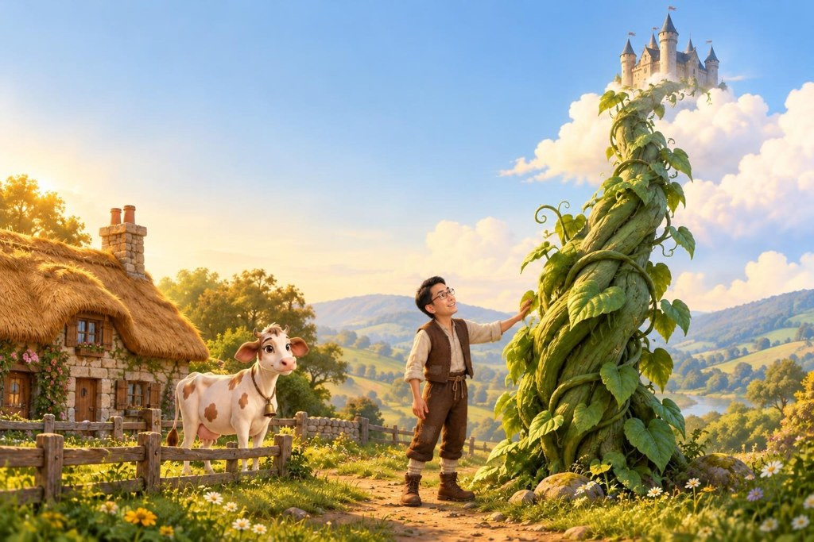 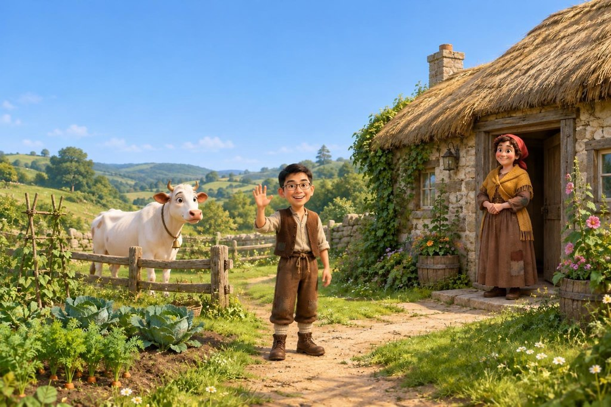 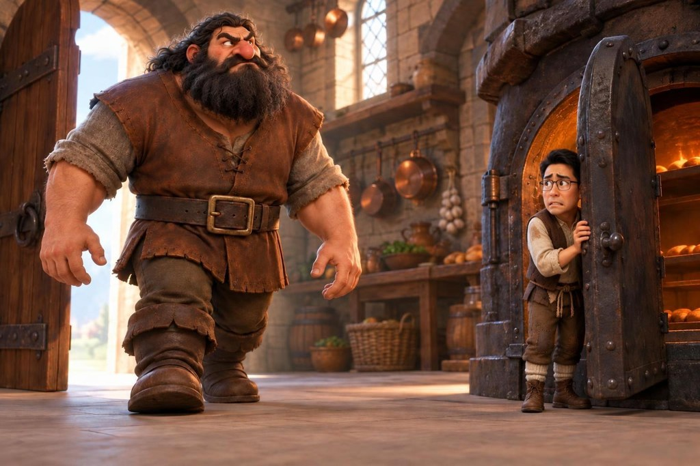

- **Looks like me:** 3/5. Clear resemblance: same haircut, glasses, skin tone and general face shape are preserved across pages. But it's a strongly stylized CGI/animation interpretation — smoother skin, slightly larger eyes and softer jawline — so it's recognizably me to people who already know me, not 'anyone would recognize me.' A few close-ups (notably pages 9 and 10 while climbing) push the cartoon proportions more than the full-body shots (pages 1–4). Glasses reflections and lens thickness vary slightly between images.
- **Rings true:** 4/5. Narrative is faithful and condensed — all the key beats of Jack and the Beanstalk are present in clear, child-friendly lines. Language and pacing feel like an actual children's picture book. A couple of small departures (the beans look very candy-like; the giant's wife is framed as a 'giant woman' who openly helps) are stylistic, not structural problems.
- **Professional:** 4/5. High-quality, consistent art direction: good color grading, coherent lighting, depth-of-field and composition across pages. Typography and image/text pairing are readable and child-appropriate. Small issues keep it from a perfect 'published book' score: minor inconsistencies in facial rendering across some close-ups, a few cartoonish visual cues (e.g. 'Zzz' over the giant) that clash with the otherwise cinematic style, and one odd detail (beans look like brightly colored candy).
- **What isn't good:** Page 6: the five 'magic beans' look like jellybeans — feels too candy-like for the scene. Pages 9–10 (beanstalk close-ups): facial proportions are noticeably more cartoonish (bigger eyes, softer jaw) compared with the earlier full-body shots. Page 13 (sleeping giant) uses 'Zzz' glyphs which are inconsistent with the otherwise filmic visual style. Minor: glasses reflections/thickness vary between images, and the uploaded photo is not used literally — it's an AI-stylized likeness rather than a faithful photoreal portrait.
- **Liked:** Very consistent overall art direction, good composition and color. Illustrations are expressive and convey the story beats clearly. Text is short and well-paced for young readers. Technical polish — lighting, shadows and depth — is strong; the book feels ready to print with only small tweaks needed.

## Lupe, 56 (Red Riding Hood): Owns a bakery in San Antonio, three grown children, first grandchild on the way. English is her second language.

 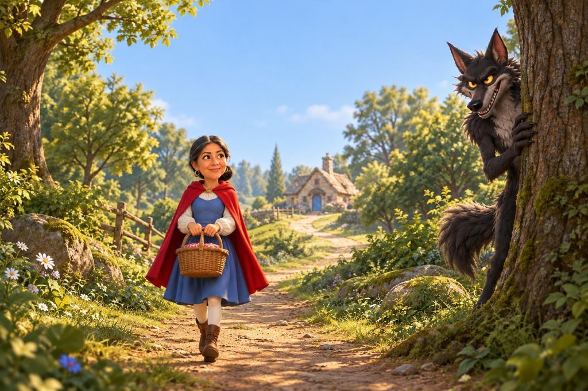 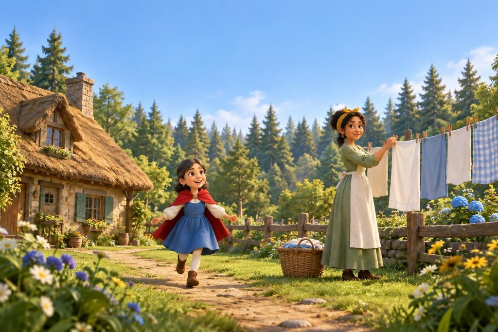 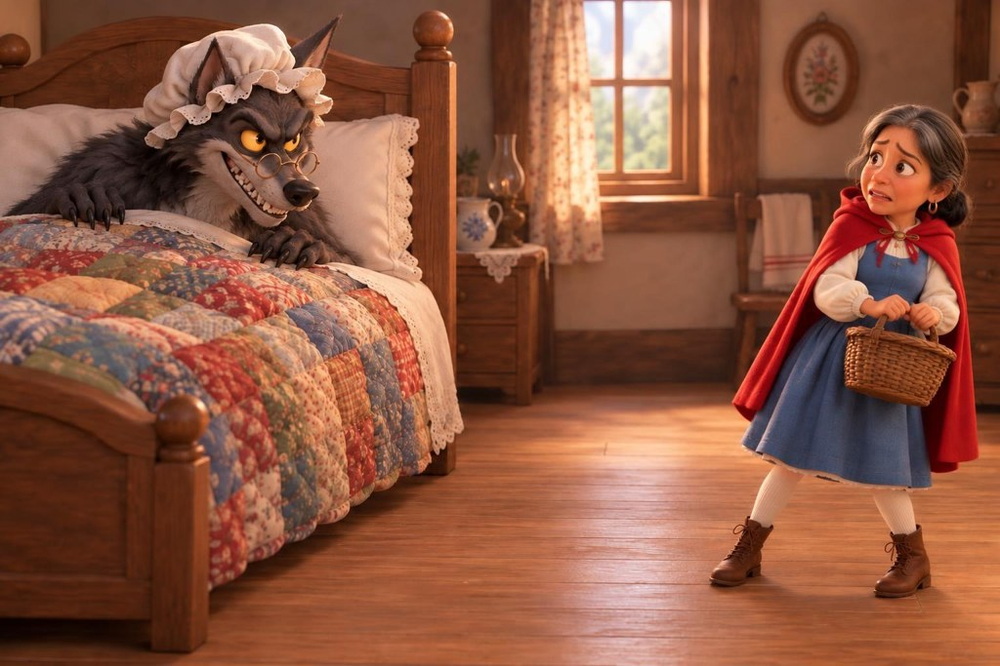

- **Looks like me:** 4/5. I give 4 because the character has my skin tone, gray hair streaks, the same smile and the gold hoops — I can see me in many pictures. But it is very cartoony and a little younger/niña at times. Close-ups on pages 5-7 and 11-15 show different expressions and look less like my real face. The cover and pages 1, 3, 9 feel most like me.
- **Rings true:** 5/5. The story is the classic Little Red Riding Hood and it reads simple and clear like a real children's cuento. Text matches the pictures, the rhythm and ending are familiar and sweet. It feels like a true kids book.
- **Professional:** 5/5. Very polished art, lovely colors, lighting, and composition. It looks like a published book — I would print it and maybe give as a regalo if the personalization is right.
- **What isn't good:** Some inconsistency with the face across pages (pages 5-7 flower picking and pages 11-15 bedroom/chase scenes), sometimes too childlike or different expressions. Page 10 knock expression is a bit odd. Page 17 wardrobe surprise and Grandma look different style than the protagonist. Small things: earrings or hair sometimes not same, and the wolf is very scary on some pages (might frighten tiny niños).
- **Liked:** I liked the warm colors, the red cape and basket, the cozy kitchen and Grandma scene, the woodcutter hero, and the happy ending. The book feels loving and would be special for my futuro nieto.

## Tyler, 19 (Jack): College sophomore in Arizona doing studies for money between classes. Wants to finish fast.

 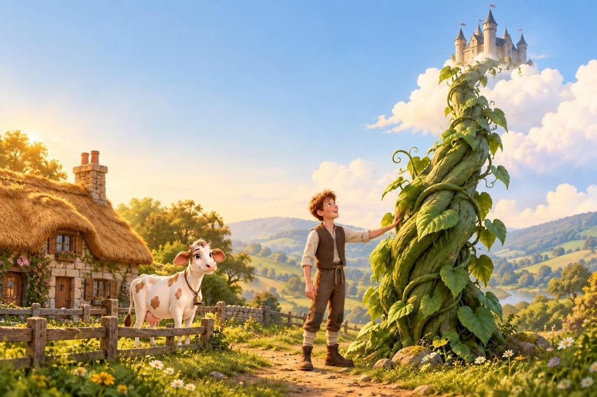 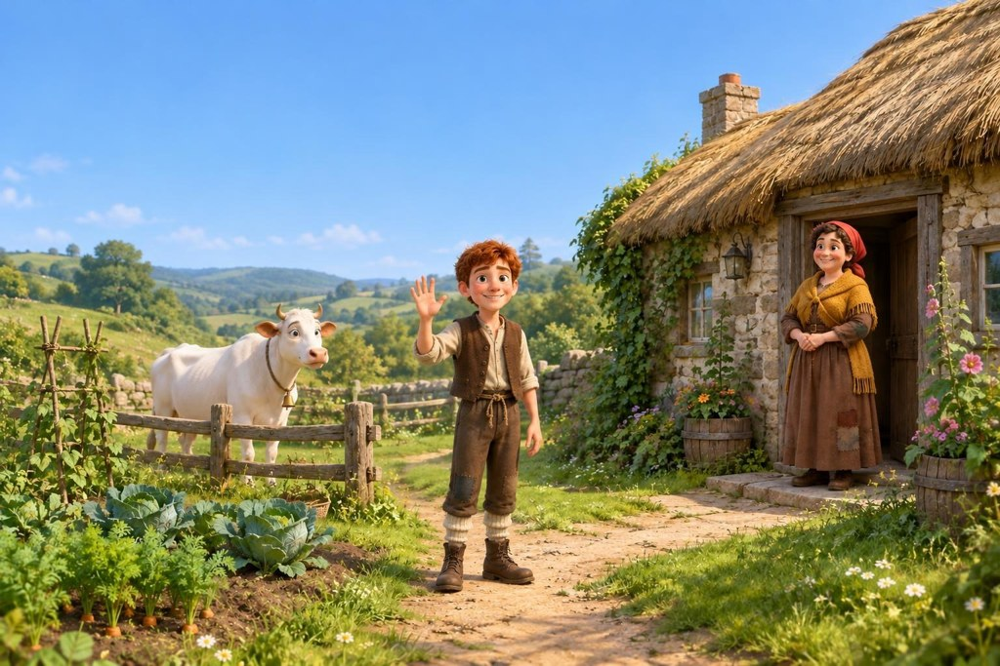 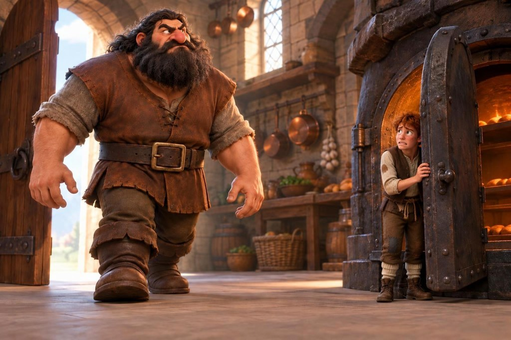

- **Looks like me:** 3/5. kinda similar hair freckles and face shape but its cartoony missing my stache and proportions closest on pages 1 9 10 others not exact
- **Rings true:** 5/5. follows the classic jack and the beanstalk beats simple text and bright pics feels like a real kids book
- **Professional:** 5/5. very polished art consistent lighting good composition looks published
- **What isn't good:** beans look like jellybeans page 6 7 was dumb face likeness off on some pages eyes and nose different page 1 9 10 ok harp personified weird page 16 giant woman a bit odd
- **Liked:** art lighting beanstalk shots pages 8 9 10 and the ending pic nice

## Grace, 63 (Red Riding Hood): Retired second-grade teacher in New Jersey. Taught reading for 30 years.

 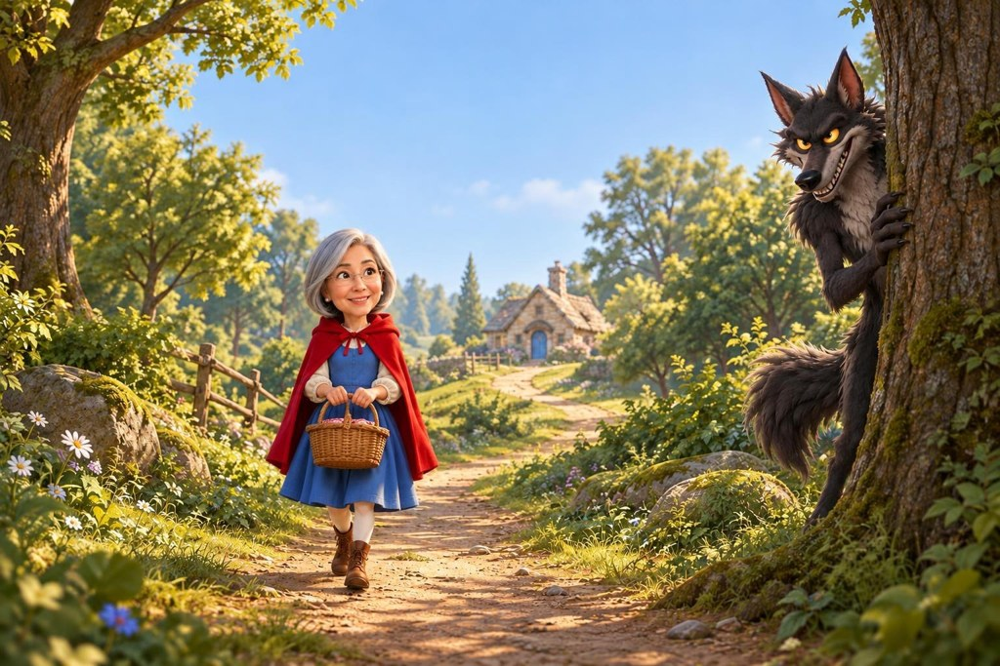 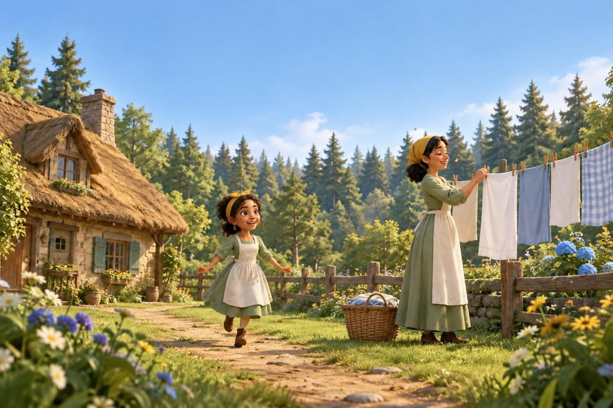 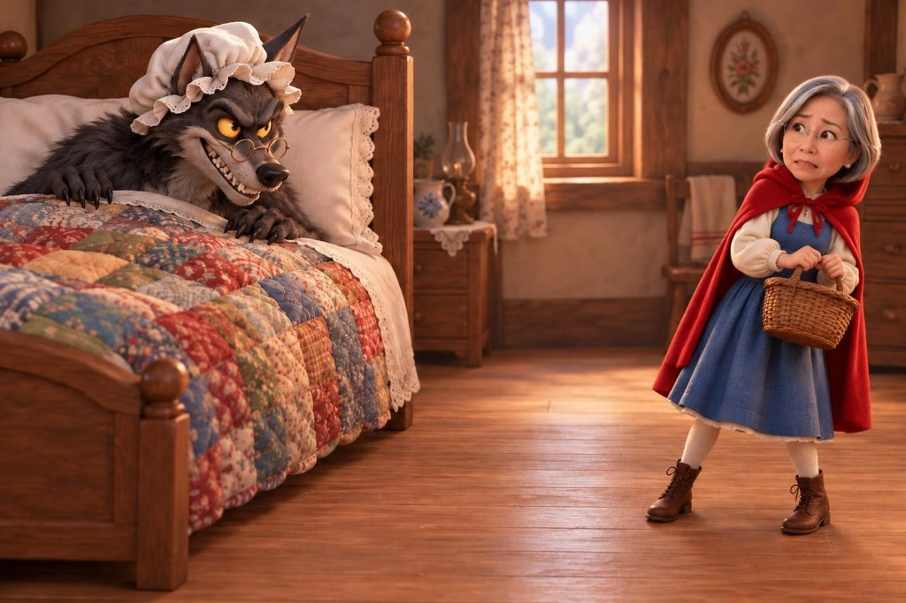

- **Looks like me:** 3/5. The face has some of my most recognisable features — the silver bob, the glasses frame, the gentle smile and the pearl earrings — so at a glance I can tell it’s meant to be me. However the images are heavily stylised and sometimes the proportions and age feel off. On the cover and a few pages (for example pages 1 and 4) the likeness reads best. On many of the action pages (pages 6–15) the face is exaggerated to fit the cartoony body and large-eyed style, and on a few pages the glasses and facial details are inconsistent, which makes the personalization feel uneven.
- **Rings true:** 4/5. The text follows the familiar Little Red Riding Hood beats and the pictures match the lines closely, so it feels like the real fairy tale and like a child’s picture book. The language is simple and readable for young listeners and the pacing is mostly right. It does feel a bit condensed in places — the wolf’s schemes and the rescue happen very quickly — but for a short personalised book that economy works.
- **Professional:** 4/5. The artwork is high quality: consistent 3-D style, lovely color palette, clear compositions and expressive characters. It looks like something a small publisher could print. I docked one point because the face-personalization is inconsistent across pages (glasses, age cues and proportions change) and a couple of scenes feel rushed in the story flow. Those small issues would make me hesitate before gifting without reviewing a final proof.
- **What isn't good:** Inconsistent facial details and age: the character sometimes looks older and sometimes very childlike (pages 3–7 and 11–15 show the biggest mismatch). The glasses are present on some spreads but missing or altered on others (notably on some of the action pages). The rescue sequence is abrupt — the woodcutter arrives very suddenly (page 15) and the wolf’s exit feels hurried (page 16), which weakens the drama. A couple of frames (page 13 with the wolf baring teeth, page 14–15 chase scenes) might be too intense for very young or sensitive children.
- **Liked:** I liked the overall charm and warmth of the illustrations, the bright, friendly color scheme, and the clear visual storytelling. The cottage and forest backgrounds are lovely, and Grandma’s reveal (page 17) and the family table scene (page 18) are particularly cozy and satisfying. The text is simple and rhythmic, perfect for reading aloud to a second grader.

## Marcus, 37 (Jack): Firefighter in Chicago, twin boys (6). Busy; would use this to surprise his kids.

 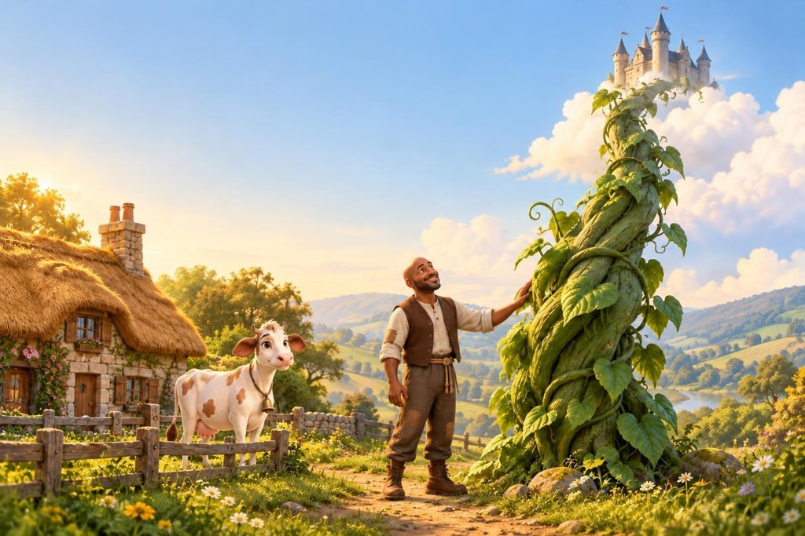 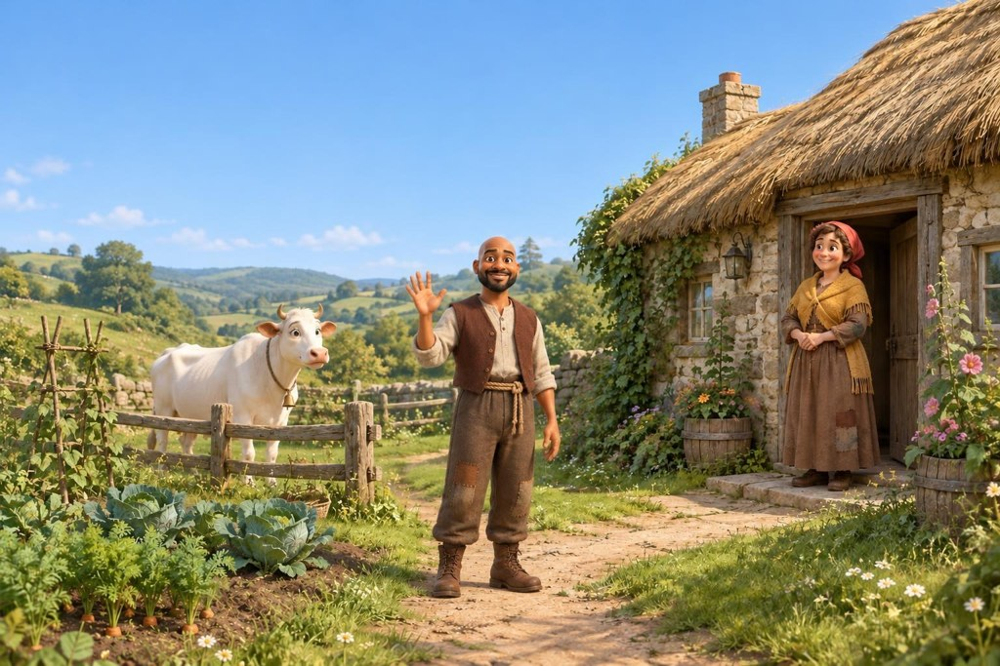 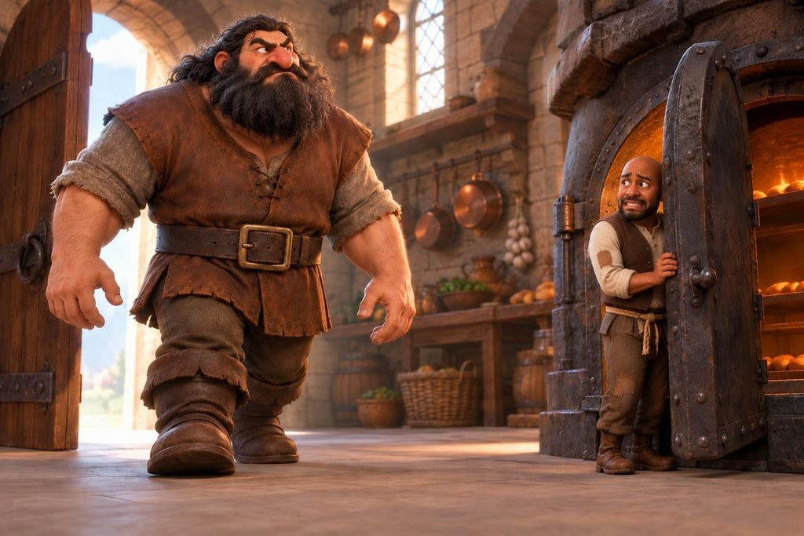

- **Looks like me:** 4/5. Bald head, beard and smile are definitely me. Pages 0, 1 and 9–10 are the most recognizable. It's stylized though — big cartoon eyes and exaggerated expressions on some close-ups (pages 6, 16, 17) make it feel less like my real face. Page 20 with the final family shot still reads like me to my boys, which is what matters most.
- **Rings true:** 5/5. Solid, faithful Jack and the Beanstalk. Text is simple and kid-friendly. Images hit the classic beats — sell the cow, magic beans, beanstalk, castle, hen, harp, chase, chop. Feels like a real children's picture book.
- **Professional:** 5/5. Looks like studio-level art. Consistent style, great color and composition. Layout and pacing feel polished. I would print it and gift it. I'd pay 99¢ to surprise the twins.
- **What isn't good:** Page 6–7: the beans look like candy/jelly beans instead of mysterious magic beans. Pages 6, 16, 17: facial features get a bit too cartoonish (huge eyes, extra-wide grins) which breaks likeness. Page 20: the kid in the final shot looks like an extra character — slightly confusing who is who. Minor skin-tone/proportion shifts on a few close-ups.
- **Liked:** My boys would freak out seeing Dad as the hero. The beanstalk and climbing shots (pages 9–10) are awesome. Colors, lighting and the happy final scene are lovely. Overall very fun and gift-ready.

## Priya, 45 (Red Riding Hood): Professional children's book illustrator in Boston, one son (8).

 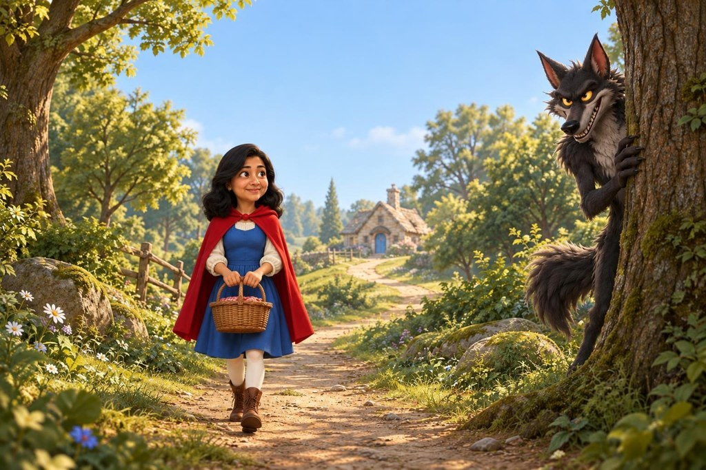 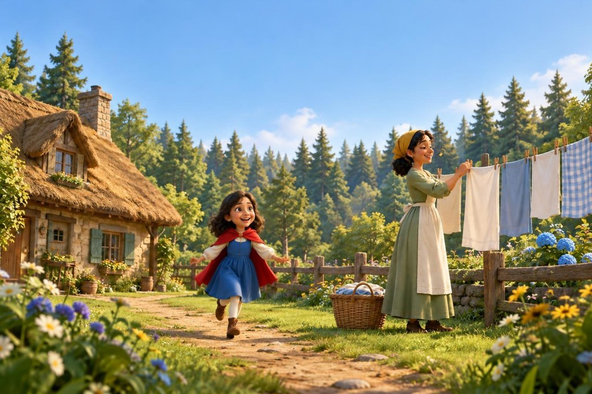 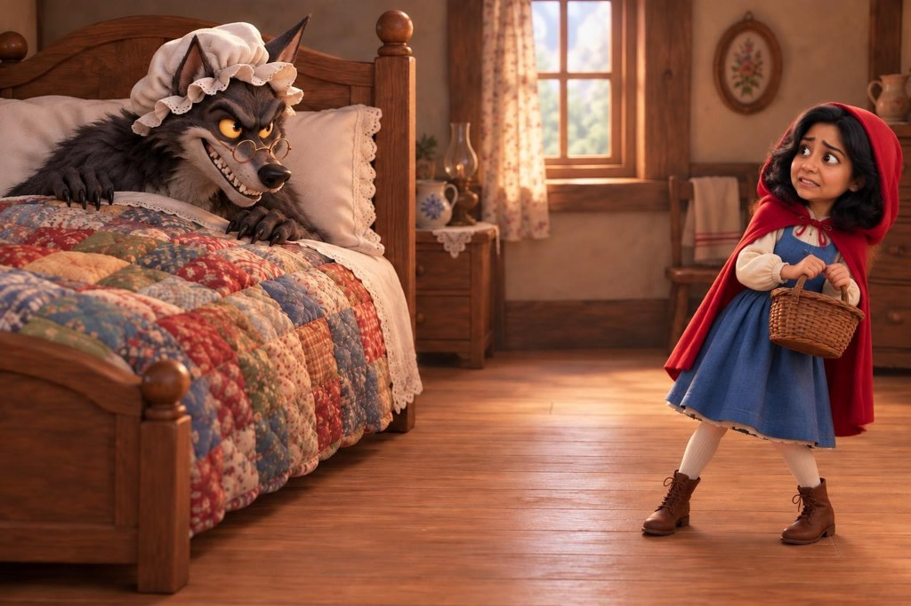

- **Looks like me:** 3/5. There's a decent likeness in hair mass, general face shape and smile — the 3D 'Red' reads as you at a glance. But it's heavily stylized (childified Pixar look) so age, proportions and small ID cues are lost: no nose stud, brows/eyes are exaggerated, and facial proportions wobble from page to page (some pages read older, some very childlike). Pages where it reads best: cover, pages 3–4, 9. Pages where the face drifts off-model: 6 (eyes too wide), 11–13 (expressions look older/more angular), 14–15 (panic expressions feel like a different face).
- **Rings true:** 4/5. Narrative beats and pacing follow the classic tale cleanly — clear beginning, obstacle, climax, rescue and tidy moral. Image staging sells the story (establishing shots, close-ups, action spread). It reads like a picture-book retelling, but the text treatment is generic and the woodcutter/grandma reveal could use stronger connective beats (a couple of turns feel abrupt).
- **Professional:** 3/5. Rendering, color and lighting are high-quality — polished 3D look, strong color keys, charming production design. BUT as an art director I see problems that stop this from being 'publish-ready': on-model inconsistency, several anatomy/hand issues, awkward basket/hand interaction, sometimes sloppy perspective (feet/ground contact), and zero typographic design — text is pasted-on. For a commercial printed product I'd want fixes before paying/buying as a finished book.
- **What isn't good:** Consistency: character model drifts across pages (face proportions, hair length, missing nose stud) — pages 6, 11–13, 14–15. Hands and grips: Red's hands are stiff or float through props on pages 3, 6 and 12; wolf paw anatomy inconsistent (overly human finger shapes vs paw pads) on pages 5, 11, 13–14. Perspective/grounding: uneven foot contact/weight on pages 4, 7 and 14. Anatomy/expression: some panic poses look like a different character (pages 14–15). Composition/typography: text is unintegrated — risky over busy backgrounds (esp. pages 1, 7, 9). Also the wardrobe/Grandma reveal feels narratively thin — why a wardrobe? needs a visual hint earlier (page 8–10).
- **Liked:** Love the production design — cottage, quilt, props, florals, and the warm evening palette. Lighting and atmosphere are excellent; compositions have good silhouette and clear focal points in most spreads (cover, pages 4, 8, 18). The wolf design is expressive and the humor/tension beats read well. With tighter character consistency, fixed hands and a considered typographic layout this could be a very sweet, giftable picture book.

## Sam, 24 (Jack): Grad student in Portland. Cares about privacy and about who gets represented in kids' books.

 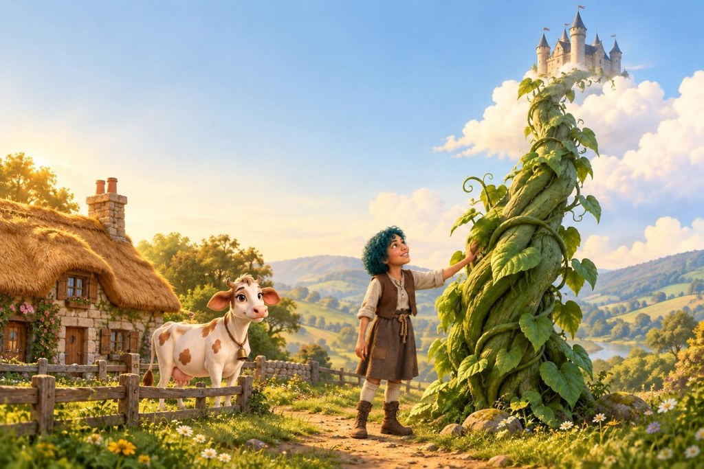 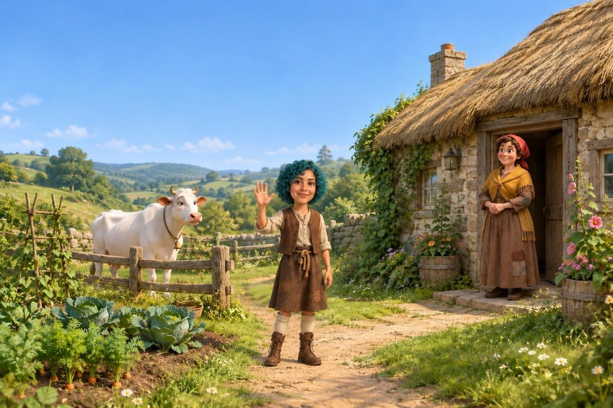 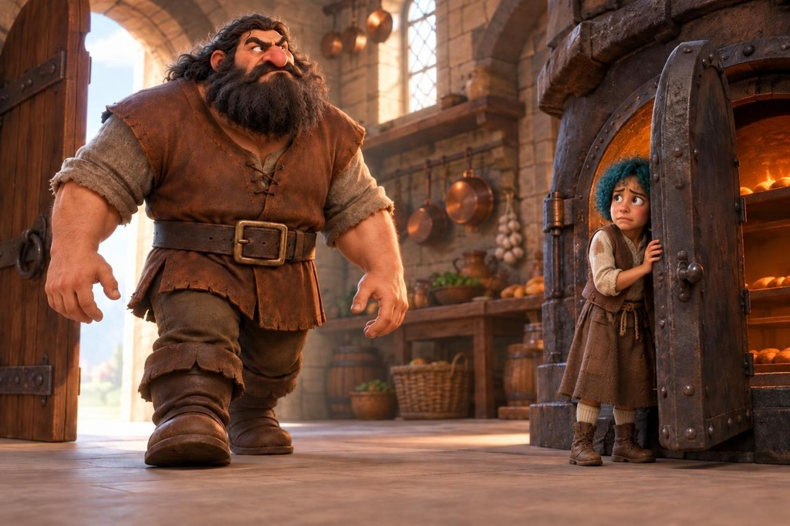

- **Looks like me:** 4/5. Overall this is a good likeness — the hair color and curl, face shape and general skin tone are captured well, and the character carries my expression and posture in several close-ups (pages with clear face shots: 1, 2, 5, 9, 10, 15, 16). It’s clearly the same person stylized into a cartoon kid: big eyes, softened features and slightly exaggerated proportions. That stylization is fine for a picture book, but small details wobble across pages (some images smooth or shift shading/tones and a couple of frames feel like a different, more stereotypical ‘Jack’).
- **Rings true:** 5/5. The text follows the classic Jack and the Beanstalk beats and the pacing/readability fits a children's picture book — simple sentences, clear cause-and-effect, and the images match the lines closely. It feels coherent, playful and faithful to the fairy tale while working as a kid-friendly read-aloud.
- **Professional:** 5/5. The art is polished and consistent in style, colors, and composition — the pages look like they came from the same illustrator. Framing, lighting and character expressions are high quality. I’d feel comfortable printing or gifting this; it’s on par with published children’s picture books rather than a rough AI demo.
- **What isn't good:** A few continuity hiccups: the hero's look shifts a little between pages (some panels feel slightly different in face detail or proportions, which can read as different people — page 20 in particular shows an extra boy character that confuses who 'Jack' actually is). The five beans look a bit like candy when they fly out the window (page 6/7) — a stylistic choice but jarring. Minor detail inconsistencies (small costume/necklace/piercing treatments and skin shading) crop up across pages and could be tightened.
- **Liked:** I liked that the app handled a non‑traditional Jack really respectfully — teal curly hair, expression and personality come through, which matters for representation in kids’ books. The images are warm, expressive and funny (giant’s kitchen, the sleeping scene, the singing harp) and the color palette and composition are delightful.
